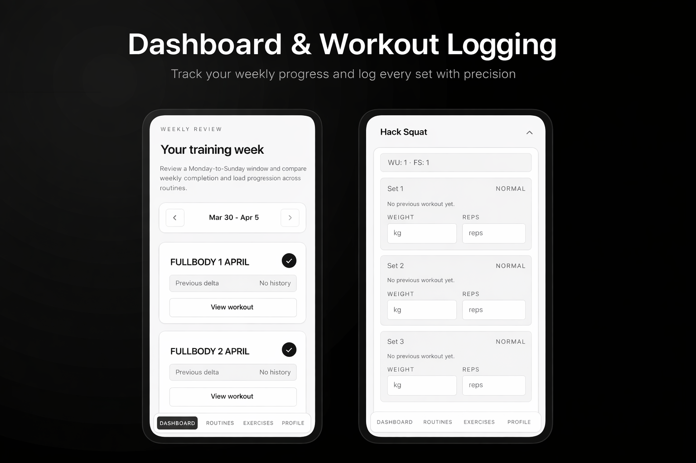

<p align="center">
  <picture>
    <source media="(prefers-color-scheme: dark)" srcset="./public/gainly_logo_white.png" />
    
  </picture>
</p>

<p align="center"><strong>Plan your routines. Log your sets. Review your training week.</strong></p>

<p align="center">
  <a href="#english">English</a> ·
  <a href="#quick-start">Quick start</a> ·
  <a href="#current-scope">Current scope</a> ·
  <a href="#development">Development</a> ·
  <a href="#português">Português</a>
</p>

<p align="center">
  
</p>

## English

Gainly is a web app for strength-training routines and workout logs. Build a routine from your exercise library, record weights and reps during a session, and review completion and changes across Monday-to-Sunday weeks.

The frontend uses React, TypeScript, and Vite. Convex stores account data, routines, and workout sessions and supplies live updates to the app.

### What you can do

- Create, rename, duplicate, reorder, activate, and deactivate routines
- Build routines with rep ranges, warmup and feeder sets, back-off sets, clusters, and supersets
- Keep a personal exercise library with descriptions and muscle-group filters
- Log weights in kilograms and repetitions, including both exercises in a superset
- Reopen a routine's weekly session and see values from earlier completed workouts
- Review weekly completion, progress summaries, and planned sets per muscle group
- Use the interface in English or Brazilian Portuguese, with light, dark, or system theme

The exercise library belongs to your account. The routine builder and workout logger reuse those entries.

### Quick start

You need Git, pnpm, and a Convex development deployment. Node.js 22 or 24 is recommended. This checkout was installed with Node.js 24.19.0 and pnpm 11.19.0.

Use the pnpm lockfile for reproducible installation. The committed npm lockfile is currently out of sync with `package.json`.

1. Clone the repository and install its locked dependencies.

   ```sh
   git clone https://github.com/enzosinger/gainly.git
   cd gainly
   pnpm install --frozen-lockfile
   ```

2. Configure the backend and keep this command running in the first terminal.

   ```sh
   pnpm exec convex dev
   ```

   Follow the CLI prompts to select or create your development deployment. Check that `.env.local` contains the deployment configuration and `VITE_CONVEX_URL`. The [Convex React quickstart](https://docs.convex.dev/quickstart/react) explains this flow. The values in [`.env.example`](./.env.example) are placeholders.

3. For a new deployment, configure Convex Auth's `JWT_PRIVATE_KEY` and `JWKS` using the [official signing-key setup](https://labs.convex.dev/auth/setup/manual#configure-private-and-public-key).

   The manual example imports `jose`. Create a temporary folder outside this checkout. Run `pnpm add jose` there. Run the linked `generateKeys.mjs` example in that folder. This keeps the key-generation dependency and private key files out of the app repository.

   Set these values on the Convex deployment. Keep them out of frontend `VITE_*` variables and version control. This repository already contains its auth provider, schema, and HTTP routes, so retain those files. An existing deployment with working authentication does not need new keys.

4. Start the frontend in a second terminal.

   ```sh
   pnpm dev
   ```

   Open the URL Vite prints, usually `http://localhost:5173`.

### First workout

1. Create an account.
2. Add an exercise in **Exercises**.
3. Create a routine in **Routines**.
4. Add the exercise and its sets to the routine.
5. Open the workout from the dashboard.
6. Record a set.
7. Complete the session to check the full flow.

New accounts start without routines or exercises. The screenshots show example data.

### Configuration

| Value | Where it belongs | Purpose |
| --- | --- | --- |
| `CONVEX_DEPLOYMENT` | Local CLI configuration in `.env.local` | Selects the Convex deployment |
| `VITE_CONVEX_URL` | `.env.local`, or the frontend hosting environment | Connects the React client to that deployment |
| `JWT_PRIVATE_KEY` and `JWKS` | Convex deployment environment | Configures Convex Auth's signing keys |
| `CONVEX_SITE_URL` | Supplied by Convex inside backend functions | Auth issuer used by `convex/auth.config.ts` |

`SITE_URL` is a separate Convex Auth setting for redirect-based flows. The current password-only flow does not require it. See the [Convex Auth setup guide](https://labs.convex.dev/auth/setup/manual) and [Convex environment-variable reference](https://docs.convex.dev/production/environment-variables).

If the frontend fails at startup, check `VITE_CONVEX_URL` and restart Vite after changing it. If authentication fails on a new deployment, check the backend terminal and the auth key configuration.

### Current scope

- Sessions are organized by routine and week. Opening a routine again in the same week reuses its session
- Week boundaries use the browser's local timezone
- Planned weekly volume counts sets in active routine templates. It is separate from completed workout logs
- Training data lives in Convex. Gainly does not have a persistent offline workout store
- Authentication supports email and password. Password recovery and email verification are not configured
- Deleting an exercise also removes its entries from routines and workout history

For production, configure authentication on the production deployment and point the frontend at that deployment. Follow the [Convex Auth production guide](https://labs.convex.dev/auth/production). A successful local build does not verify a live deployment's authentication.

### Screenshots

- [Weekly dashboard](./docs/screenshots/dashboard.png) · [Dark theme](./docs/screenshots/dashboard-dark.png)
- [Routine builder](./docs/screenshots/routine-builder.png) · [Dark theme](./docs/screenshots/routine-builder-dark.png)
- [Workout log](./docs/screenshots/workout.png) · [Dark theme](./docs/screenshots/workout-dark.png)

### Development

```sh
pnpm test      # Run Vitest interactively
pnpm test:run  # Run the test suite once
pnpm build     # Type-check and build the frontend
pnpm preview   # Serve the built frontend locally
```

Tests use Vitest and Testing Library. Run the test suite and build before submitting a change. These checks do not exercise a real Convex deployment. For changes to authentication or persistence, also verify the affected flow against a configured development deployment.

On Node 24, disable experimental Web Storage for the test process if it conflicts with jsdom:

```sh
NODE_OPTIONS=--no-experimental-webstorage pnpm test:run
```

| Directory | Responsibility |
| --- | --- |
| `src/app`, `src/pages` | Routing, authenticated app shell, and screens |
| `src/components` | Interface components and feature views |
| `src/state`, `src/hooks` | Convex-backed state and client interaction logic |
| `src/lib`, `lib` | Training calculations and shared helpers |
| `src/i18n` | English and Portuguese interface copy |
| `convex` | Authentication, schema, queries, mutations, and session summaries |
| `docs/sources` | Architecture and domain documentation |

Start with the [repository overview](./docs/sources/00-repo-overview.md), [architecture](./docs/sources/architecture.md), [frontend](./docs/sources/frontend.md), and [backend](./docs/sources/backend.md). Contributors should also read [AGENTS.md](./AGENTS.md). Exact dependencies and commands live in [package.json](./package.json).

## Português

**Planeje suas rotinas. Registre suas séries. Acompanhe sua semana de treino.**

O Gainly é um app web para organizar treinos de musculação e registrar sessões. Monte uma rotina com sua biblioteca de exercícios, registre cargas e repetições e acompanhe os resultados em semanas de segunda a domingo. O frontend usa React, TypeScript e Vite. O Convex armazena os dados e envia atualizações ao app.

### O que você pode fazer

- Criar, renomear, duplicar, reordenar, ativar e desativar rotinas
- Montar treinos com faixas de repetições, séries de aquecimento e aproximação, back-off, cluster e superset
- Manter uma biblioteca pessoal de exercícios com descrições e filtros por grupo muscular
- Registrar cargas em quilogramas e repetições, inclusive dos dois exercícios de um superset
- Reabrir a sessão semanal de uma rotina e consultar valores de treinos anteriores concluídos
- Acompanhar a conclusão dos treinos, resumos de progresso e séries planejadas por grupo muscular
- Usar a interface em português brasileiro ou inglês, com tema claro, escuro ou do sistema

A biblioteca pertence à sua conta. O editor de rotinas e o registro de treinos usam os mesmos exercícios.

### Desenvolvimento local

Você precisa de Git, pnpm e um deployment de desenvolvimento do Convex. Recomendamos Node.js 22 ou 24. A instalação deste checkout foi verificada com Node.js 24.19.0 e pnpm 11.19.0. Use o lockfile do pnpm. O `package-lock.json` atual está desatualizado em relação ao `package.json`.

```sh
git clone https://github.com/enzosinger/gainly.git
cd gainly
pnpm install --frozen-lockfile
pnpm exec convex dev
```

Siga as instruções do CLI e mantenha o comando em execução. Confira `CONVEX_DEPLOYMENT` e `VITE_CONVEX_URL` em `.env.local`. Os valores de [`.env.example`](./.env.example) são exemplos e precisam ser substituídos.

Em um deployment novo, configure `JWT_PRIVATE_KEY` e `JWKS` no Convex seguindo a [documentação oficial de chaves](https://labs.convex.dev/auth/setup/manual#configure-private-and-public-key). O exemplo manual importa `jose`. Crie uma pasta temporária fora deste repositório. Execute `pnpm add jose` nela. Rode o exemplo `generateKeys.mjs` nessa pasta. Isso mantém a dependência e os arquivos de chave privada fora do código do app. Preserve os arquivos de autenticação que já estão neste repositório. Não coloque chaves privadas em variáveis `VITE_*` nem no Git. `CONVEX_SITE_URL` é fornecida pelo próprio Convex no backend.

Em outro terminal, execute:

```sh
pnpm dev
```

Abra a URL exibida pelo Vite, geralmente `http://localhost:5173`.

### Primeiro treino

1. Crie uma conta.
2. Cadastre um exercício em **Exercícios**.
3. Crie uma rotina em **Rotinas**.
4. Adicione o exercício e suas séries à rotina.
5. Abra o treino pelo dashboard.
6. Registre uma série.
7. Conclua a sessão para conferir o fluxo.

Contas novas começam sem exercícios ou rotinas. As capturas de tela mostram dados de exemplo.

### Escopo atual

- Cada rotina reutiliza a mesma sessão dentro de uma semana
- As semanas seguem o fuso horário local do navegador
- O volume semanal planejado conta séries nas rotinas ativas. Ele é separado dos registros de treinos concluídos
- Os dados de treino ficam no Convex. Não há armazenamento persistente de treinos offline
- O acesso usa e-mail e senha. Recuperação de senha e verificação de e-mail não estão configuradas
- Excluir um exercício também remove suas entradas das rotinas e do histórico de treinos

Para publicar o app, configure a autenticação no deployment de produção e use a URL desse deployment no frontend. Consulte o [guia de produção do Convex Auth](https://labs.convex.dev/auth/production).

### Validação e contribuição

```sh
pnpm test      # Executa o Vitest em modo interativo
pnpm test:run  # Executa a suíte uma vez
pnpm build     # Verifica tipos e gera o build do frontend
pnpm preview   # Serve o build localmente
```

Execute os testes e o build antes de enviar uma alteração. Essas verificações não acessam um deployment real do Convex. Mudanças de autenticação ou persistência também precisam ser verificadas em um deployment de desenvolvimento configurado.

No Node 24, se o Web Storage experimental conflitar com o jsdom, execute:

```sh
NODE_OPTIONS=--no-experimental-webstorage pnpm test:run
```

Consulte a [estrutura do projeto](#development), a [visão geral](./docs/sources/00-repo-overview.md), a [arquitetura](./docs/sources/architecture.md) e as [instruções para contribuição](./AGENTS.md).

## License / Licença

[MIT](./LICENSE). Keep the copyright notice and license when redistributing the software. Mantenha o aviso de copyright e a licença ao redistribuir o software.
